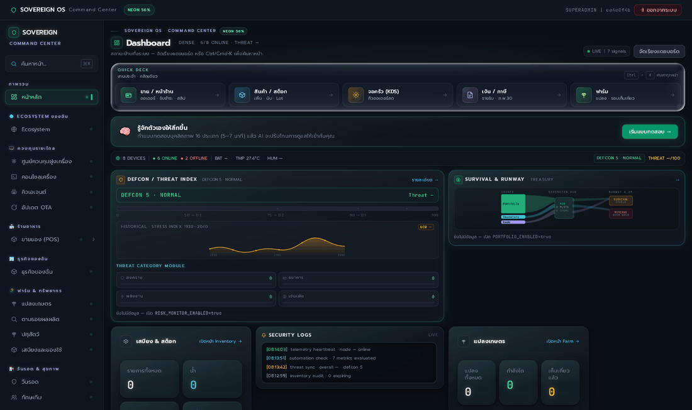

# Sovereign OS — Community Edition

**Self-hosted monitoring and automation for a home or small site: telemetry in over MQTT, history in Postgres, alerts out to Telegram / Discord / LINE. Everything runs on your own hardware.**

[ไทย](README.md) · **English**



11 real screens in 15 seconds — stills are in [`docs/media/screens/`](docs/media/screens), storyboard in [`docs/PRELAUNCH-DEMO.md`](docs/PRELAUNCH-DEMO.md).

## Quickstart (Docker — no Node.js on the host)

```bash
git clone https://github.com/krisakornutama/sovereign-origin.git
cd sovereign-origin
cp deploy/community/.env.example deploy/community/.env
```

Open `deploy/community/.env` and fill the three **required** secrets (any random string, 24+ chars):

- `POSTGRES_PASSWORD`
- `EMQX_PASSWORD`
- `JWT_SECRET`

`SEED_ADMIN_PASSWORD` is optional — leave it empty and the first boot prints a random password once.

```bash
docker compose -f deploy/community/docker-compose.yml up -d --build
```

The first build takes a few minutes (api and web are built from source; Postgres/TimescaleDB and EMQX come from upstream images).

| Service | URL |
|---|---|
| Web UI | http://localhost:3000 |
| API health | http://localhost:3001/healthz |
| MQTT broker | `localhost:1883` |
| EMQX dashboard | http://localhost:18083 |

The one-shot `migrate` service applies the schema and seeds the first admin (`admin`). If you left `SEED_ADMIN_PASSWORD` empty, read it from `docker compose -f deploy/community/docker-compose.yml logs migrate` — it is printed once.

Add another user without an SMTP server:

```bash
docker compose -f deploy/community/docker-compose.yml exec api \
  node dist/scripts/make-invite.js --role OPERATOR --days 7
```

Stop with `docker compose -f deploy/community/docker-compose.yml down` (named volumes are kept).

## What you get

- **Telemetry ingest** — MQTT topic `sovereign/<node>/sensor/<device>`, stored in TimescaleDB, with dashboard, history charts and alert rules.
- **Alert fanout** — one alert goes to Telegram, Discord and LINE in parallel. A channel that fails (500, dead webhook) is reported per channel and never blocks the others.
- **Invite-code signup instead of SMTP** — codes are stored only as a SHA-256 hash, single-use by default, with expiry, max uses and revocation. No mail server, no open registration.
- **Consent and privacy built in** — consent records per purpose, telemetry/analytics opt-in, privacy policy ships with the app, audit log for security-relevant actions.
- **Operational basics** — health endpoints, backup, TOTP MFA for admins, offline-capable PWA.

## Requirements

- Docker Engine + Compose v2 (Docker Desktop on Windows/macOS)
- 2 GB RAM minimum, ~10 GB disk
- x86_64 or arm64 — the compose file is plain Linux containers, so Raspberry Pi 4/5 should work (not yet tested by me; reports welcome)

## Measured footprint

Idle, 4 containers, Windows 11 + Docker Desktop, measured 2026-11-04 with `docker stats`:

| Container | RAM |
|---|---|
| api | 94 MiB |
| web | 61 MiB |
| postgres | 78 MiB |
| mqtt (EMQX) | 141 MiB |

## Architecture

```
sovereign-os/core-api/      Express + Prisma backend (58 modules)
sovereign-frontend/         Next.js dashboard
deploy/community/           Dockerfile-based CE stack + .env.example
tools/                      installers, gates, CI helpers
docs/                       design docs, demo storyboard, open-core boundary
```

## Development

```bash
# backend (:3001)
cd sovereign-os/core-api && npm ci && npx prisma generate && npm run dev

# frontend (:3000)
cd sovereign-frontend && npm ci && npm run dev
```

Before opening a PR:

```bash
cd sovereign-os/core-api && npm test        # backend tests
cd sovereign-frontend && npm run typecheck && npm run build
node tools/verify/open-core-boundary.mjs    # must report 0 violations
```

## Tests

| Suite | Command | Status (2026-11-06) |
|---|---|---|
| Backend | `cd sovereign-os/core-api && npm test` | 1,823 tests · 1,822 pass · 0 fail · 1 skipped |
| Tooling / CI guards | `npm run test:tools` | 1,287 pass · 0 fail · 6 skipped |
| Type check + build | `cd sovereign-frontend && npm run typecheck && npm run build` | clean |

## Open-core

This repository is pure Community Edition: no hidden Pro imports, no dead stubs. Commercial modules (retail/POS, treasury, fleet control) live in a separate private repository. If a Pro module is absent, its API returns a 404 that names the module instead of crashing the server, and a CI gate fails the build if CE ever imports Pro code. The boundary is documented in [`docs/OPEN-CORE.md`](docs/OPEN-CORE.md).

## Docs

- [`CHANGELOG.md`](CHANGELOG.md) — release history and what changed in each version (latest: v1.3.0)
- [`QUEUE.md`](QUEUE.md) — current work queue and launch status
- [`deploy/community/README.md`](deploy/community/README.md) — install, ports, invite codes, LAN access (Thai)
- [`deploy/community/README.en.md`](deploy/community/README.en.md) — the same install guide in English
- [`docs/FAQ-REDDIT.md`](docs/FAQ-REDDIT.md) — canned answers for launch comments
- [`docs/PRELAUNCH-DEMO.md`](docs/PRELAUNCH-DEMO.md) — demo storyboard and how to reproduce it
- [`docs/OPEN-CORE.md`](docs/OPEN-CORE.md) — what stays in CE and what moved to Pro
- [`docs/ARCHITECTURE.md`](docs/ARCHITECTURE.md) — system design and module boundaries

## License

[AGPL-3.0](LICENSE) — use it, modify it, ship it. If you run a modified version as a network service, you have to publish your changes.

## Known limitations

- **Alert channels**: Telegram is verified end-to-end. Discord and LINE payloads are verified against local stub endpoints (format, headers, plain-text conversion, `@allowed_mentions` hardened) but have not been fired at real webhooks yet.
- **Platform**: tested on Windows 11 + Docker Desktop. macOS and Raspberry Pi are untested.
- **No mobile app** — the web UI is a PWA.
- **Pro modules are not here** — POS, accounting and fleet control are deliberately excluded.

Found a bug or a doc that assumes too much? Open an issue — that is exactly the feedback this release is looking for.
