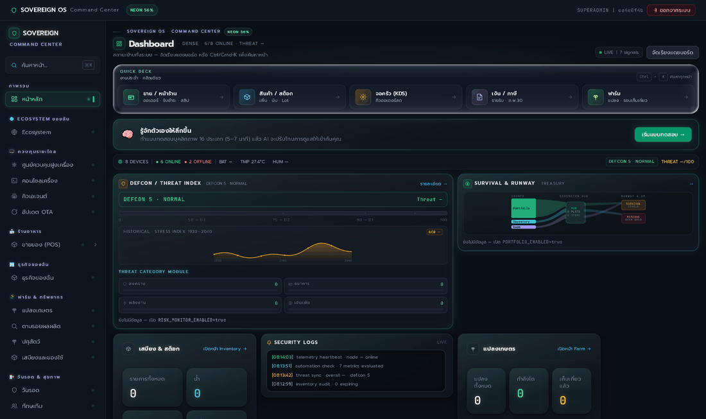

# Sovereign OS

ระบบบ้านอัจฉริยะ Sovereign ที่ดูแลตัวเองได้ (Self-Sovereign Home OS) — Security, Resilience, AI และ Telemetry ในชุดเดียว
ทดสอบ 994/994 tests ผ่าน 100% · core-api รันบน RAM ~220MiB, CPU <0.5%

> **Community Edition (Docker อย่างเดียว — ไม่ต้องมี Node.js บนเครื่อง):**
> `cp deploy/community/.env.example deploy/community/.env` แล้ว `docker compose -f deploy/community/docker-compose.yml up -d --build`
> ดูรายละเอียดที่ [`deploy/community/README.md`](deploy/community/README.md)

## 🎬 เดโม 15 วินาที

ลำดับ: `docker compose up -d` → ค่าอุณหภูมิเปลี่ยน → หน้าแจ้งเตือนเด้ง → มือถือได้รับ Telegram/Discord/LINE

<!-- วางไฟล์คลิปที่ docs/media/demo.gif แล้วเปิดบรรทัดล่างนี้ (GitHub ฝัง GIF ได้ แต่ MP4 จะเป็นลิงก์ดาวน์โหลด) -->
<!--  -->

สตอรีบอร์ด + คำสั่งจำลองอุณหภูมิ + สคริปต์ยิง alert จริง: [`docs/PRELAUNCH-DEMO.md`](docs/PRELAUNCH-DEMO.md)

## 🖥️ รับช่วงต่อบนเครื่องใหม่ (clone แล้วรันได้เลย)

```bash
git clone https://github.com/krisakornutama/sovereign-origin.git
cd sovereign-origin
```

**ทางเร็วสุด — Community Edition ด้วย Docker (ไม่ต้องมี Node.js บนเครื่อง)**

```bash
cp deploy/community/.env.example deploy/community/.env
# แก้ SEED_ADMIN_PASSWORD ใน .env ก่อน (ถ้าเว้นว่าง ระบบจะสุ่มให้และพิมพ์ใน log)
docker compose -f deploy/community/docker-compose.yml up -d --build
```

- เว็บ `http://localhost:3000` · API `http://localhost:3001/healthz` · MQTT `1883`
- ผู้ใช้เริ่มต้น `admin` (รหัสอยู่ใน `deploy/community/.env`)
- เพิ่มสมาชิกด้วยรหัสเชิญ: หน้า **Users → การ์ดรหัสเชิญ** หรือ
  `docker compose -f deploy/community/docker-compose.yml exec api node dist/scripts/make-invite.js --role OPERATOR --days 7`
- หยุด: `docker compose -f deploy/community/docker-compose.yml down` (ข้อมูลยังอยู่)

**โหมดพัฒนา (แก้โค้ดแล้วเห็นผลทันที)**

```bash
cd sovereign-os/core-api && npm ci && npx prisma generate && npm run dev   # :3001
cd sovereign-frontend && npm ci && npm run dev                              # :3000
```

**รันเทสต์ก่อนแก้โค้ด** — API: `cd sovereign-os/core-api && npm test` · เว็บ: `cd sovereign-frontend && npm run typecheck && npm run build`
ด่านกัน Pro หลุดเข้า CE: `node tools/verify/open-core-boundary.mjs` (ต้องได้ 0 จุด)

## 🚀 ติดตั้งครั้งเดียวใช้งานได้เลย (One-Shot Install)

**ต้องมี Docker ก่อน** (Windows: Docker Desktop / Linux: docker engine + compose v2) **+ Node.js 20+**

**Windows — ดับเบิลคลิก:**
```bat
tools\install\install.cmd
```

**Linux / macOS:**
```bash
node tools/install/install.mjs
```

ตัวติดตั้งครั้งเดียวทำ **ทั้งโปรเจ็กต์** ในเทิร์นเดียว: ตรวจ prerequisite → สร้าง env ทุกชั้น (`infra/.env`, `core-api/.env`, `frontend/.env`, `agent-runner/.env` — สุ่ม secret ให้ รันซ้ำไม่ทับค่าเดิม) → `docker compose up -d` → รอ healthy → ตรวจสุขภาพ API จริง → (ถ้า `--with-runner`) ลงทะเบียน scheduled task ของ agent runner แล้วตรวจสอบย้อนหลับด้วย `schtasks /Query` → พิมพ์ URL + รหัสล็อกอิน

### Flags

| Flag | ความหมาย |
|---|---|
| `--dry-run` | ดูแผน + .env ที่จะสร้าง (ทุกความลับถูกปิด) โดยไม่ลงมือใด ๆ |
| `--verify-only` | ตรวจระบบอย่างเดียว ไม่แตะไฟล์/ไม่สั่ง compose |
| `--with-runner` | ติดตั้ง agent runner + ลงทะเบียน scheduled task บนเครื่องนี้ด้วย |
| `--with-runner --machine-token=…` | ใส่ token จากหน้า Agent Queue ล่วงหน้า |
| `--no-frontend` | ข้าม Dashboard (กันชน port 3000) |
| `--prod` | ใช้ docker-compose.prod.yml (build production images) |
| `--force` | สร้าง `infra/.env` ใหม่จากเทมเพลต (สำรองไฟล์เก่า .bak) — **รหัส DB เดิมจะเปลี่ยน** |

ตัวติดตั้งเก่า (`install.ps1` / `install.sh`) ยังใช้ได้เหมือนเดิม — ทำเฉพาะส่วน Docker stack

### Flags

| Flag | ความหมาย |
|---|---|
| `--auto` / `-Auto` | เงียบสนิท ใช้ค่า default ทั้งหมด (เหมาะ Raspberry Pi / ติดตั้งห่างสายตา) |
| `--prod` / `-Prod` | ใช้ docker-compose.prod.yml (build production images) |
| `--no-frontend` / `-NoFrontend` | ข้าม Dashboard (กันชน port 3000) |
| `--dry-run` / `-DryRun` | ดูแผน + .env ที่จะสร้าง โดยไม่ลงมือ |
| `--force` / `-Force` | สร้าง .env ใหม่จาก template (สำรองไฟล์เก่า .bak) |
| `--telegram-token=…` / `-TelegramToken` | ใส่ Telegram token ล่วงหน้า |

## ⚙️ หลังติดตั้ง — เปิดฟีเจอร์เสริม (ทั้งหมดไม่บังคับ)

| ฟีเจอร์ | วิธีเปิด |
|---|---|
| **Telegram Alert** (แจ้งเตือน severity เกรด production) | ใส่ `TELEGRAM_BOT_TOKEN` + `TELEGRAM_CHAT_ID` ใน `infra/.env` → `docker compose up -d` |
| **UPS Shutdown** (แบตเตอรี่ถึงขีด → CHECKPOINT → ปิดเครื่อง) | `UPS_ENABLED=true` + มี NUT server (`upsd`) → ระวัง `UPS_DRY_RUN` |
| **AI / Ollama** (Dhamma, Agent, Analyst) | ติดตั้ง Ollama แล้วเปิด `AI_ANALYST_ENABLED=true` + ตั้ง `OLLAMA_MODEL` |
| **การลงทุน** (Portfolio) *(Pro — ไม่อยู่ใน CE)* | `PORTFOLIO_ENABLED=true` + ตั้งพอร์ต/ราคา |
| **เซนเซอร์ IoT** (MQTT) | ต่อ ESP32 ส่ง MQTT ไป EMQX (`sovereign/…`) |

## 🏠 ทรัพยากรขั้นต่ำ

- x86_64 (แนะนำ) / arm64, Docker, RAM ≥ 2GB, disk ~10GB
- ระบบหลัก ~1.5–2GB RAM รวม (core-api 220MiB + Postgres + Timescale + EMQX)
- AI (Ollama) เพิ่มอีก ~4–8GB RAM ตามโมเดล

## 📂 โครงสร้าง

```
sovereign-os/
  core-api/     ← Backend (Express + Prisma, ทุกโมดูล 38 modules)
  infra/        ← docker-compose (dev/prod) + .env (ไม่เข้า git)
sovereign-frontend/  ← Dashboard (Next.js)
docs/           ← Blueprint เอกสารออกแบบ (SERIES_RED_DMS_BLUEPRINT.md) + คู่มือ Google Search Console สำหรับเว็บ portfolio (google-search-console-guide.md)
tools/install/  ← ตัวติดตั้งคลิกเดียว
```

## 🧪 ทดสอบ

```bash
cd sovereign-os/core-api
npm test   # 994 tests (tsx --test, serial)
npm run build  # tsc ตรวจ type + build dist/
```

## 🗺️ ถนนสู่ชุด 🔴 (หลัง Soak Phase 3–7 วัน)

- External Dead-Man Switch (ESP32-S3 + 4G) — ดู `docs/SERIES_RED_DMS_BLUEPRINT.md`
- Cold Standby Machine (Postgres replication + Wake-on-LAN)

## 📄 License และขอบเขต Open-Core

- **Community Edition (โค้ดใน repo นี้):** [AGPL-3.0](LICENSE) — ใช้/แก้/ต่อยอดได้ ถ้าให้บริการแบบเครือข่ายต้องเปิดโค้ดที่แก้ด้วย
- **Pro modules (แยกออกแล้ว 04/11/69):** business / shop / treasury / POS / fleet อยู่ใน private repo `project-sovereign-pro` — repo นี้เหลือ CE ล้วน API ของโมดูล Pro ตอบ 404 พร้อมบอกชื่อโมดูล (ไม่ทำให้ทั้ง API ล่ม)
- เส้นแบ่งฉบับเต็ม + สิ่งที่ห้ามตัดออกจาก CE (consent, privacy, audit): [`docs/OPEN-CORE.md`](docs/OPEN-CORE.md)

> ⚠️ ตอนนี้ repo ยังมีทั้งสองส่วนรวมกัน — ห้ามโพสต์ประชาสัมพันธ์ว่า "CE พร้อมใช้" จนกว่าจะแยกเสร็จ (คิว `ai/open-core-split`)
